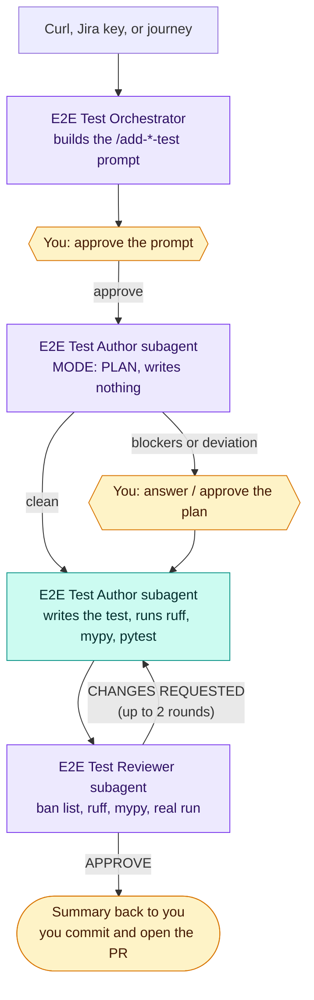
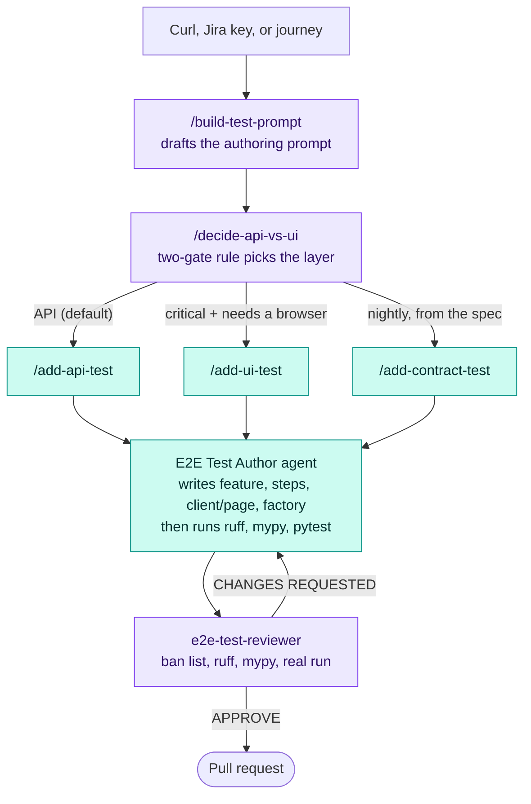
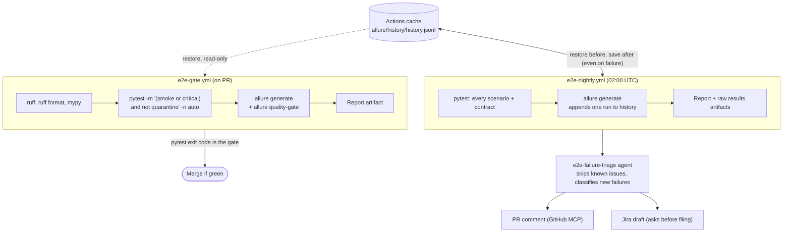

# MontyCloud E2E Automation Suite

API-first, UI-supported **end-to-end** BDD automation for the MontyCloud platform.
One language (Python), one runner (**pytest + pytest-bdd**), one combined report (**Allure 3**).

> **Status:** infrastructure + GitHub Copilot authoring layer are complete and verified
> (`ruff`/`mypy` clean, deps resolve, `pytest` collects). There are **no `.feature` tests yet** —
> the first golden exemplars (one API journey, one UI journey) are authored next, using the
> `/add-*` skills below.

E2E / system-level only — **no unit tests**. Tests exercise the running, **deployed** system
(the MontyCloud backend is AWS serverless; there is no local server to boot). Default target
environment: **dev1**.

---

## Table of contents

1. [Architecture & the two-gate rule](#1-architecture--the-two-gate-rule)
2. [Prerequisites](#2-prerequisites)
3. [Installation](#3-installation)
4. [Configuration (`.env`)](#4-configuration-env)
5. [Running tests](#5-running-tests)
6. [The Allure 3 report](#6-the-allure-3-report)
7. [Writing a new test](#7-writing-a-new-test)
8. [Tag taxonomy](#8-tag-taxonomy)
9. [Project layout](#9-project-layout)
10. [Code quality](#10-code-quality)
11. [CI/CD](#11-cicd)
12. [AI failure triage](#12-ai-failure-triage)
13. [Troubleshooting & FAQ](#13-troubleshooting--faq)
14. [Versions & compatibility](#14-versions--compatibility)
15. [Where to go next](#15-where-to-go-next)

---

## TL;DR

```bash
git clone <repo-url> && cd Automation
python3.12 -m venv .venv && source .venv/bin/activate     # Python 3.11+
pip install -e . --group dev
playwright install                                         # browsers
npm install                                                # Allure 3 report CLI
cp .env.example .env                                       # fill in dev1 creds (never commit)

pytest -m "(smoke or critical) and not quarantine"        # run the gate subset
npm run report:generate && npm run report:open            # view the Allure report
```

To add a test, open the repo in VS Code / Copilot and start the **E2E Test Orchestrator** agent with a
curl, Jira key, or journey — or run the `/decide-api-vs-ui` skill, then `/add-api-test` or `/add-ui-test` (see [§7](#7-writing-a-new-test)).

---

## 1. Architecture & the two-gate rule

| Layer | Tool | Share | Marker |
|---|---|---|---|
| **API E2E** (the workhorse) | `httpx` | ~70% | `@api` |
| **Contract / fuzz E2E** | `schemathesis` (from OpenAPI) | nightly | `@contract` |
| **UI E2E** (thin, critical) | Playwright (`pytest-playwright`) | ~30% | `@ui` |
| **Reporting** | Allure 3 | — | — |

**Two-gate rule — what earns a UI test:** (a) is the journey *critical*, **and** (b) does it
*genuinely need a browser* (the value is the rendered experience or a true cross-system flow)?
If an API call can prove it, it's an **API** test, not a UI one. **Default new tests to API.**

**Strict layering** — each layer talks only to the one below:

```
.feature (declarative Gherkin)      ← business intent, no mechanics
   └─ step definitions (thin glue)  ← orchestration only; no logic/HTTP/locators/asserts
        └─ domain layer             ← API client objects + page objects (actions live here)
             └─ support / infra     ← config, fixtures, factories, base client, assertions
```

See [CONTRIBUTING.md](CONTRIBUTING.md) for the full Definition of Done and the ban list.

---

## 2. Prerequisites

| Requirement | Why | Check |
|---|---|---|
| **Python 3.11+** | the suite's own venv (decoupled from the app's 3.7 runtime) | `python3 --version` |
| **Node 18+** (20+ recommended) | Allure 3 CLI (+ optional Playwright MCP) | `node --version` |
| **dev1 access** | tests hit the deployed dev1 API/UI | see [§4](#4-configuration-env) |
| **No-MFA test user** | logs in via `/auth/signin` for API/UI calls | from the platform team |

If you don't have Python 3.11+: `brew install python@3.12` (macOS) or use `pyenv`/`uv`.
If your Node is old: `brew install node` or `nvm install 20`.

---

## 3. Installation

```bash
cd Automation

# 1. Python venv (3.11+) + the suite (editable) + dev tools
python3.12 -m venv .venv
source .venv/bin/activate
pip install -e .                      # runtime deps from pyproject.toml
pip install --group dev               # pinned ruff/mypy/pre-commit (pip >= 25.1)

# 2. Playwright browsers (for UI tests)
playwright install                    # or: playwright install --with-deps chromium

# 3. Git hooks (ruff + mypy on commit)
pre-commit install

# 4. Node tooling — Allure 3 report CLI
npm install

# 5. Environment
cp .env.example .env                  # then fill it in (see §4)

# 6. (optional) Atlassian MCP for Jira/Confluence — config in .vscode/mcp.json.
#    VS Code Copilot opens a browser for OAuth on first use. The Copilot coding agent
#    (cloud) can't do OAuth — set it up in repo Settings > Copilot > coding agent with an
#    API token stored as the secret COPILOT_MCP_ATLASSIAN_API_KEY.
```

> The Allure **3** CLI ships as the npm package `allure` (in `devDependencies`). `npm install`
> makes `npm run report:*` work. To use `allure` directly anywhere, `npm i -g allure`.

---

## 4. Configuration (`.env`)

All config is a single typed object (`tests/support/config.py`, `pydantic-settings`). Every var
is prefixed `E2E_` and loaded from `.env` (gitignored) or real env vars in CI. Copy
`.env.example` and fill in:

| Variable | Purpose | Where to get it |
|---|---|---|
| `E2E_ENV` | target env label (default `dev1`) | — |
| `E2E_API_BASE_URL` | dev1 API base URL | platform team / OpenAPI `servers` |
| `E2E_UI_BASE_URL` | dev1 app URL (for Playwright) | platform team |
| `E2E_TEST_USERNAME` / `E2E_TEST_PASSWORD` | dedicated **no-MFA** test user (logs in via `/auth/signin`) | platform team (secret) |
| `E2E_TEST_USERS` | extra users by role/tenant, JSON: `{"read_only": {"username": "…", "password": "…"}}` | platform team (secret) |
| `E2E_AUTH_HEADER_SCHEME` | blank = raw token; `Bearer` = `Bearer <token>` | confirmed: blank (raw) |
| `E2E_API_KEY` | `x-api-key` header — blank if endpoints don't need it | platform team (secret) |
| `E2E_OPENAPI_SPEC` | path/URL to the richer OpenAPI spec | drives `@contract` layer |

Failure triage and Jira are handled by Copilot agents via the **Atlassian MCP** (`.vscode/mcp.json`),
not by env config.

**How auth works:** `tests/support/auth.py` logs in **once per session** via the platform's
`POST /auth/signin` (the same endpoint the app uses) over httpx, **caches** the tokens, and
**refreshes** them (`POST /auth/refresh-token`) just before expiry — so requests make no per-call
login. The cached ID token is sent as `Authorization` (raw, no `Bearer`); `x-api-key` is added
only when set. Tests never handle tokens directly — the `api_client` fixture attaches headers and
**retries once on a 401** after refreshing.

- **Other roles / tenants:** `api_client_as("read_only")` signs in as a user from
  `E2E_TEST_USERS` (cached per session). Use it for permission tests ("read-only can't delete")
  and tenant isolation ("tenant B can't read tenant A's data"). An unknown name fails the test.

- **Negative-auth tests:** use the `unauthenticated_api_client` fixture (no auth headers) to
  assert `401`/`403`, or pass `headers={"Authorization": "bad"}` to a request to test a bad token.
- **UI auth:** UI tests start **pre-authenticated** — `tests/support/ui_auth.py` mints a token and
  injects it as a Playwright `storage_state` (arrange-via-API login), so no test logs in through
  the form except the login journey, tagged `@logged_out` (fresh context, no API sign-in).

> ⚠️ **Never commit `.env`.** It is gitignored. In CI, the same values come from GitHub secrets.

---

## 5. Running tests

```bash
# By layer / selection (tags)
pytest -m api                       # API E2E only
pytest -m ui                        # UI E2E only
pytest -m "(smoke or critical) and not quarantine"   # the PR gate subset (fast)
pytest                              # the full nightly set (everything, incl. @quarantine)
pytest -n auto --dist loadfile      # in parallel (what CI does)

# Targeting
pytest tests/step_defs/api/test_customer_account.py     # one file
pytest -k "create and account"                          # by name substring
pytest tests/step_defs/api/test_customer_account.py::test_create   # one test

# Useful flags
pytest -v                           # verbose (one line per scenario)
pytest -x                           # stop at first failure
pytest -ra                          # summary of skips/fails (already in addopts)
pytest --alluredir=allure-results   # already set in pyproject; results for the report
```

> Until the first `.feature` is authored, `pytest` reports **"no tests collected"** — that's
> expected, not an error.

**Parallelism:** `pytest-xdist` is installed; CI runs `-n auto --dist loadfile` (one feature
file per worker, so a feature's scenarios stay together). Scenarios are independent because data
is namespaced (`e2e-<hex>`) and arranged via the API. Each worker signs in once. Mind shared-dev1
rate limits; `429`s are retried by `ApiClient`.

**Timeouts:** every test gets 300s (`timeout` in `pyproject.toml`, pytest-timeout). A hung call
or browser fails that test instead of stalling CI. Override one test with
`@pytest.mark.timeout(600)` only with a reason.

### When a test fails: where the evidence is

- **API:** every call in the Allure report has an attachment named `METHOD /path -> status`
  with the request and response (headers with secrets masked, bodies up to 20k chars), the
  elapsed time, and the AWS request ids (`x-amzn-RequestId`, `x-amzn-Trace-Id`). Search
  CloudWatch Logs for the request id, or X-Ray for the trace id.
- **Correlation id:** all calls in one test share an `X-Correlation-Id` header (in each
  attachment), so you can find that test's calls in backend logs if the service logs it.
- **UI:** a failed UI test attaches a full-page screenshot and the page URL. The Playwright trace
  is kept in `test-results/` (CI artifact `playwright-traces-*`); open it with
  `playwright show-trace test-results/<test>/trace.zip`.
- **Report header:** `environment.properties` (env, base URLs, commit) is written by pytest, so
  every report says which environment produced it.
- **Contract tests** report through JUnit XML (`allure-pytest-bdd` only reports Gherkin
  scenarios). Nightly runs them as a separate step that writes
  `allure-results/contract-junit.xml`; each failure names the schemathesis check and gives a
  `curl` to reproduce it.

---

## 6. The Allure 3 report

```bash
npm run report:generate   # build a single self-contained allure-report/index.html (+ append history)
npm run report:gate       # exit 1 if any critical-severity test failed (CI runs this on PRs)
npm run report:open       # open the report (lands on it directly — no folder to click)
npm run report:watch      # live-updating report while you run tests locally
npm run report:clean      # optional: wipe allure-results/ + allure-report/ (history is kept)
```

`pytest` wipes `allure-results/` itself (`--clean-alluredir`), so each report shows one run.

What the report gives you:

- **Stakeholder grouping** — `epic / feature / story` (set via tags/decorators on tests).
- **History / trends** — **self-hosted** in `allure/history/history.jsonl` (no SaaS, per EU +
  GOVCloud data-residency). It sits outside `allure-results/` and `allure-report/`, so cleaning
  never touches it; each `allure generate` appends one run (capped by `historyLimit`).
  Nightly restores it from the Actions cache and saves it even on failure. PRs restore it
  read-only. Locally it is gitignored and builds up from your own runs.
- **Testing pyramid (Graphs tab)** — Allure's default unit / integration / e2e chart. This repo
  fills only the `e2e` layer (`layer=E2E` on every test, contract included). The unit and
  integration layers fill once the platform (pytest) and UI (Jest) repos' results for the same
  `dev` commit are pulled in, each labelled `layer=unit` or `layer=integration` in its own repo.
- **Categories** — failures bucketed (quarantined / infrastructure / product defect / test
  defect) by the `categories` rules in `allure/allurerc.mjs`.
- **Quality gate** — `npm run report:gate` exits 1 on any critical-severity failure (rules in
  `allure/allurerc.mjs`, run via `allure/qualitygate.mjs` to dodge an Allure 3.13 bug where
  `historyPath` silently skips the gate). The hard PR gate is still pytest's exit code.
- **Known issues** — `allure/known-issues.json` labels known/blocked items separately from new
  failures (sync from Jira where possible).

> The Python adapter (`allure-pytest-bdd`) emits Allure **2** result JSON; the Allure **3** CLI
> renders it. History and the quality gate are verified on Allure 3.13.1.

---

## 7. Writing a new test

Two ways in. The **E2E Test Orchestrator** agent runs the whole flow and stops only where a human
is needed (§7.1, recommended). Or run the skills one at a time (§7.2).

### 7.1 Automatic: the E2E Test Orchestrator (recommended)



<sub>Purple: read-only. Teal: writes the test files. Amber: a human decides.</sub>

In Copilot Chat, pick **E2E Test Orchestrator** in the agent picker and give it a curl, a Jira
key, a journey description, or a draft prompt. It follows `/build-test-prompt` (asking any
blocking questions first), shows you the prompt, and — once you approve it — hands over to the
author and reviewer as **subagents** with no further clicks. It asks you again only when:

| Checkpoint | When it stops for you |
|---|---|
| Clarify | Blocking unknowns before the prompt is built (layer, arrange strategy, async polling, shared resources, non-default env) |
| 1. Prompt | **Always** — approve, edit, or stop |
| 2. Plan | The author's plan has blockers (creds, base URL, spec, unconfirmable response shape), deviates from the approved prompt, or needs a ban-list exception / destructive dev1 operation |
| 3. Implement | The author is blocked, or the real `pytest` run fails for an environment reason |
| 4. Review | The reviewer still requests changes after two automatic fix rounds, or the author disputes a blocker |

It never commits, pushes, opens PRs, or touches Jira — the final summary comes back to you.
Subagents have no chat history and can't ask you questions, so the orchestrator passes them
everything and relays their questions.

**Model setup (Claude Sonnet 5, 1M context, high thinking).** Every agent file sets
`model: "Claude Sonnet 5 (copilot)"`, which the subagents use. In the VS Code (Local) harness:

- Start the orchestrator with **Claude Sonnet 5** selected in the model picker. The docs don't say
  the main agent honours `model:`, and a subagent whose model is above the conversation model's
  cost tier is refused.
- Open the **>** arrow next to the model name in the picker and choose the **1M** context and the
  **High** thinking effort. There's no per-agent setting for either in this harness, and the docs
  don't say whether subagents inherit them.
- If VS Code flags the `model:` value, replace it with the name its completion inserts.

**Limits (per the VS Code / GitHub Copilot docs, Oct 2026).**

- The automatic handover uses the **VS Code (Local) harness**. Subagent restriction (`agents:`)
  and handoffs are Local-only. The Copilot harness and the GitHub cloud coding agent don't run
  this flow — use the manual skills (§7.2) there.
- The cloud coding agent expects runtime model IDs, not `Claude Sonnet 5 (copilot)`. If an agent
  (e.g. triage) runs in the cloud, check its `model:` value there.
- The orchestrator asks you through the `vscode/askQuestions` tool. If that tool isn't available,
  it asks in a chat message and waits for your reply.

### 7.2 Manual: run the skills one at a time



<sub>Purple: read-only (never writes files). Teal: writes the test files.</sub>

The `/…` commands above are **agent skills** in `.github/skills/<name>/SKILL.md` (Copilot no longer
supports `.prompt.md` prompt files). Run one by typing `/<name>` plus its argument in Copilot Chat;
each sets `disable-model-invocation: true`, so it only runs when you invoke it.

#### Decide the layer (always first)

Apply the [two-gate rule](#1-architecture--the-two-gate-rule). In Copilot:

```
/decide-api-vs-ui  "user enables a Day2 bot and sees it become active"
```

It returns a verdict (API / UI / contract) + tags and tells you which `/add-*` skill to run.

#### Add an API test (the common case)

**With Copilot (recommended):**

```
/add-api-test  "create a customer account, then retrieve it"      # or a Jira key, e.g. PRO-1234
```

The `e2e-test-author` agent loads the rules + templates, plans the files, and writes a declarative
`.feature`, thin step defs, a per-resource `httpx` client object, a Polyfactory factory, and
Allure-step assertions — fully tagged — then runs `ruff`/`mypy`/`pytest`.

**Manually:** follow the templates in
`.github/instructions/e2e-best-practices.reference.md` (§1–6). In dependency order:

1. **Model + factory** (`tests/support/models/`, `tests/support/factories.py`).
2. **Client object** (`tests/support/clients/<resource>_client.py`) — extends the Allure-wrapped
   `ApiClient`; encapsulates paths/serialization.
3. **Feature** (`tests/features/api/<journey>.feature`) — declarative; happy path + ≥1 negative;
   `Background` for auth; tags `@api @smoke`/`@critical`/`@regression`.
4. **Step defs** (`tests/step_defs/api/test_<journey>.py`) — thin glue; `parsers.parse`; call
   domain assertions.
5. Run `ruff check . && ruff format --check . && mypy && pytest tests/step_defs/api/test_<journey>.py`.

#### Add a UI test (thin, critical only)

```
/add-ui-test  "login, then the cost dashboard renders my data"    # or a Jira key
```

Uses the Python `playwright` CLI (`playwright codegen`) / Playwright MCP to find **role-based**
locators on the live dev1 app, seeds state
**via the API** (never the UI), asserts structure with an **ARIA snapshot**
(`to_match_aria_snapshot`), and attaches screenshots/traces to Allure on failure. Templates: §7–9.

> ⚠️ Playwright `codegen` / Test Agents emit **TypeScript**. Output **must be materialized as
> Python `pytest-bdd`** step defs + page objects. Every locator self-heal must log a loud warning.

#### Add a contract / fuzz test (nightly)

```
/add-contract-test  customer_account        # or an endpoint group / tag, or "all"
```

Wires `schemathesis` against `E2E_OPENAPI_SPEC`, authenticated, scoped to an endpoint group,
excluding destructive ops on shared dev1. Marked `@contract` (nightly-only). Template: §10.

#### Review before you push

```
# In Copilot, switch to the e2e-test-reviewer agent (read + lint only)
```

It checks your diff against the layering rules + ban list and returns APPROVE / CHANGES
REQUESTED. Or run the gates yourself: `ruff check . && ruff format --check . && mypy`.

---

## 8. Tag taxonomy

One scheme drives three jobs: **what runs**, **what gates a PR**, **how the report groups**.

| Tag | Meaning | Used by |
|---|---|---|
| `@smoke` | fast must-pass checks | PR gate |
| `@critical` | business-critical journeys | PR gate |
| `@api` | API-level E2E | layer selection |
| `@ui` | UI E2E (browser) | layer selection |
| `@regression` | full regression set | nightly |
| `@contract` | schemathesis contract/fuzz | nightly |
| `@quarantine` | known-flaky, pulled from the PR gate (humans only, see §8.1) | nightly only |

Plus Allure `epic` / `feature` / `story` for leadership-readable grouping, and an `@allure.link`
to a Jira requirement on at least one scenario per feature.

- **PR gate:** `pytest -m "(smoke or critical) and not quarantine"`
- **Nightly:** `pytest` (every scenario, incl. `@contract` and `@quarantine`)

### 8.1 Quarantining a flaky test (humans only)

Quarantine pulls a known-flaky test out of the PR gate so it stops blocking merges, while it
keeps running nightly so you can see when it's fixed. It is a **human decision**: Copilot agents
never add or remove `@quarantine`; the triage agent can only recommend it.

**Before you quarantine**, confirm the test is actually flaky, not a real regression:
- the triage agent labelled it `flaky`, and
- the Allure history shows it flipping between pass and fail on the same code.

If it fails every time, it's a regression or a test bug: fix it or file it, don't quarantine.

**To quarantine:**
1. Open a Jira ticket for the flake (owner, suspected cause, link to the failing report).
2. Tag the scenario (or the whole `Feature:`) with `@quarantine`, and put the ticket key and
   reason in a comment on the line above:

   ```gherkin
   # Quarantined: PRO-1234, intermittent 504 from the cost-sync Lambda (2026-11-02, owner: your-name)
   @quarantine
   Scenario: User sees the monthly cost summary
   ```

3. Open a PR. A QA reviewer approves it; the tag never goes in with an unrelated change.

**What changes:** the PR gate skips the test (`and not quarantine`). Nightly still runs it, and
in the Allure report its failures land in the **Quarantined (known flaky)** category, separate
from new failures.

**To release:** once the fix is merged and the test passes nightly for about a week, remove the
tag and the comment in a PR that links the ticket, then close the ticket.

**Review the list weekly** so quarantine doesn't become a graveyard:

```bash
pytest -m quarantine --collect-only -q
```

Anything quarantined for more than two sprints should be fixed or deleted.

---

## 9. Project layout

```
Automation/
├── pyproject.toml            # deps + pytest/ruff/mypy config (single source of truth)
├── package.json              # Allure 3 report CLI (Node tooling)
├── conftest.py               # root fixtures: settings, authenticator, api_client
├── .env.example              # env template (copy to .env; secrets out of repo)
├── AGENTS.md                 # agent source-of-truth (conventions, ban list, commands)
├── CONTRIBUTING.md           # Definition of Done + PR checklist
├── allure/                   # Allure 3 config, categories, known-issues, self-hosted history
├── .vscode/mcp.json          # Atlassian (Jira/Confluence) MCP for VS Code Copilot
├── .github/
│   ├── copilot-instructions.md
│   ├── instructions/         # e2e-best-practices.instructions.md (+ .reference.md templates)
│   ├── skills/               # <name>/SKILL.md: build-test-prompt, decide-api-vs-ui, add-api-test, add-ui-test, add-contract-test
│   ├── agents/               # e2e-test-orchestrator, e2e-test-author, e2e-test-reviewer, e2e-failure-triage
│   └── workflows/            # e2e-gate (PR) + e2e-nightly
└── tests/
    ├── features/  api/ ui/   # Gherkin (.feature) — declarative, stakeholder-readable
    ├── step_defs/ api/ ui/   # thin step definitions
    ├── support/              # config, auth, api_client, factories, assertions, pages/, clients/, models/
    └── contract/             # schemathesis wiring
```

---

## 10. Code quality

Test code is held to the **same bar as production code**.

```bash
ruff check .            # lint
ruff format --check .   # format (drop --check to auto-format)
mypy                    # strict type-checking
```

`pre-commit install` wires `ruff` + `mypy` to run on every commit. CI runs all three and fails
the build on any violation. Config lives in `pyproject.toml` (`[tool.ruff]`, `[tool.mypy]`).

---

## 11. CI/CD

GitHub Actions (`.github/workflows/`):



- **`e2e-gate.yml`** (on PRs) — `ruff` + `ruff format` + `mypy`, then `pytest -m "(smoke or
  critical) and not quarantine" -n auto --dist loadfile` (with nightly history restored read-only), then `allure generate` and `allure
  quality-gate`, uploads the report artifact. The hard gate is pytest's exit code.
- **`e2e-nightly.yml`** (cron 02:00 UTC + manual) — restores Allure history; runs every
  scenario in parallel (`-m "not contract" -n auto`, `@quarantine` included), then the
  schemathesis contract tests (JUnit into the same results), then the `e2e-` data sweeper;
  saves history even on failure; uploads the report, raw results (for the triage agent) and
  Playwright traces of failed UI tests.

**Required GitHub secrets** (Settings → Secrets → Actions): `E2E_API_BASE_URL`, `E2E_UI_BASE_URL`,
`E2E_TEST_USERNAME`, `E2E_TEST_PASSWORD`, `E2E_API_KEY` (if endpoints need it), and (nightly)
`E2E_OPENAPI_SPEC`. (The Atlassian MCP for the coding agent uses its own
`COPILOT_MCP_ATLASSIAN_API_KEY` secret — see §3.)

---

## 12. AI failure triage

Triage is the **`e2e-failure-triage`** Copilot agent (`.github/agents/`), not a script. After a run
(locally on `allure-results/`, or on the nightly CI artifacts), invoke it in Copilot: it excludes
known issues (via the Atlassian/Jira MCP), classifies only **new** failures
(`regression | flaky | env | test-bug`), dedupes, drafts a root-cause summary, and posts it to the
PR / Jira. Determinism gates — the agent only accelerates triage; it never blocks the PR gate and
never edits tests.

---

## 13. Troubleshooting & FAQ

| Symptom | Cause / fix |
|---|---|
| `no tests collected` | Expected in the skeleton — author a `.feature` (see §7). |
| `ModuleNotFoundError: tests.support` | Activate the venv and run `pip install -e .`. `pythonpath=["."]` is set in `pyproject.toml`. |
| `allure: command not found` | Run `npm install` (local) or `npm i -g allure`. Needs Node 18+. |
| `Executable doesn't exist … playwright` | Run `playwright install`. |
| `/auth/signin` 401 or a "challenge" error | Check `E2E_TEST_USERNAME/PASSWORD`; the user must be **no-MFA** with a **permanent** password (no NEW_PASSWORD / MFA challenge). |
| schemathesis "spec not found" | Set `E2E_OPENAPI_SPEC` to a reachable OpenAPI 3.x spec. |
| `ruff`/`mypy` fail on commit | Run them locally and fix the root cause — they are not suppressed. |
| pytest can't find Python 3.11+ | Create the venv with `python3.12`/`python3.13`; the app's 3.7 is unrelated. |

**Why pytest + pytest-bdd (not duplicate)?** pytest-bdd is a *plugin on top of pytest* — one
runner. The `.feature` + step defs *become* pytest tests; there's no second copy.

**What about retries and flaky waits?** `ApiClient` retries connection errors, `429`/`5xx`
on idempotent calls, and an expired token. When the backend is eventually consistent, poll with
`wait_until` (`tests/support/polling.py`, exponential backoff 0.5s → 5s cap), never `sleep`. Failed tests are never re-run: a flaky
test is a bug to triage, not to retry until green.

**Why arrange-via-API?** dev1 is shared and DynamoDB has no easy rollback. Seeding via API with
namespaced/ephemeral data keeps tests independent and cleanable. Never seed through the UI.

---

## 14. Versions & compatibility

Pinned to **latest compatible**, verified resolvable (`uv pip install -e .`). See `pyproject.toml`.

| Package | Pin | Note |
|---|---|---|
| pytest | `>=8.3,<9.2` → resolves to **9.1.1** | schemathesis 4.21 *requires* pytest ≥9; pytest 9.2 breaks pytest-bdd 9.0 |
| pytest-bdd | `>=8.1.0,<10` | BDD layer (plugin on pytest) |
| pytest-playwright / playwright | `>=0.8.0` / `>=1.60.0` | UI E2E |
| httpx | `>=0.28.1` | API E2E |
| schemathesis | `>=4.21.0` | v4 — major rewrite from v3 |
| allure-pytest-bdd | `>=2.16.0` | emits Allure **2** results |
| **Allure 3 CLI** (npm `allure`) | `^3.12.0` | the v3 report generator |
| polyfactory / pydantic / pydantic-settings | `>=3.3.0` / `>=2.13.0` / `>=2.14.0` | data + config |
| ruff / mypy | `==0.17.3` / `==2.4.1` | quality bar; exact pins (dev group + `.pre-commit-config.yaml`), bumped together |

**Open items to validate as tests land:** (1) Allure 3 rendering of `allure-pytest-bdd` results +
v3 config keys; (2) schemathesis→Allure reporting path; (3) the richer `E2E_OPENAPI_SPEC`.

---

## 15. Where to go next

- [`AGENTS.md`](AGENTS.md) — the conventions source-of-truth (read first when authoring).
- [`CONTRIBUTING.md`](CONTRIBUTING.md) — Definition of Done + the ban-list PR checklist.
- `.github/instructions/e2e-best-practices.instructions.md` (+ `.reference.md`) — rules + templates.
- `.github/skills/` — the `/build-test-prompt`, `/decide-api-vs-ui` and `/add-*` authoring skills.
